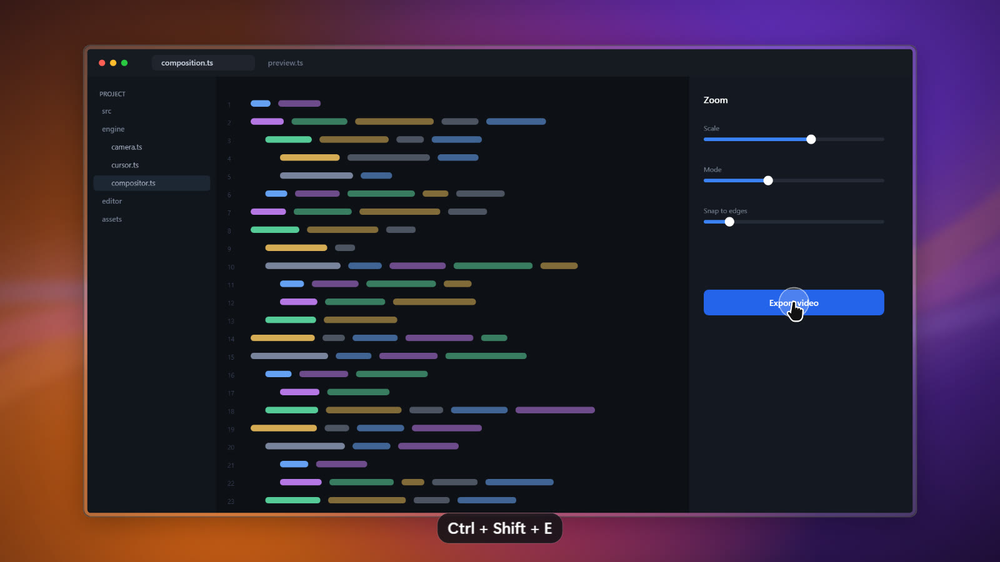

# Screen Record

A Windows screen recorder that turns a raw capture into a finished video. It records the screen
without the cursor, then re-renders everything on top: the camera zooms into what you click, the
cursor is redrawn and smoothed, and the recording sits on a background with padding, rounded
corners and a shadow. The editor is a timeline where every one of those decisions can be changed.



<sub>An exported frame, rendered by the app's own compositor. The application inside the frame is a
mock-up drawn in code, not a real capture.</sub>

Windows only. There are no prebuilt downloads yet — build it from source with the steps below.

## What it does

**Recording** — capture a display, a single window, or a region. Microphone, system audio and a
webcam are recorded as separate tracks, so they can be mixed, muted or hidden afterwards. Mouse and
keyboard events are saved alongside the video, which is what makes the rest possible.

**Automatic zoom** — each burst of clicks becomes a zoom segment aimed at the first click. While
zoomed, the camera follows the cursor: it holds still while the cursor stays near the middle, and
re-centres once the cursor leaves. Every segment can be retimed, retargeted, disabled or deleted.

**Motion** — the cursor and the camera are driven by springs, with slow, medium, quick and rapid
presets and tension, friction and mass underneath. Motion blur is separate for zooming, panning,
the cursor and the webcam.

**Looks** — generated wallpapers, gradients, solid colours or your own image for the background;
padding, corner radius, an inset bezel and adjustable shadow for the screen; four cursor styles and
sizes; circle or ripple click effects, with an optional click sound.

**Editing** — trim, cut, change speed, blur or highlight a region, and switch the webcam between a
bubble, fullscreen and hidden. Keyboard shortcuts appear on screen as pills. Export to MP4 up to
4K, or to GIF.

## Build from source

Requires Node.js 20 or newer.

```sh
npm install
npm run fetch-ffmpeg   # downloads ffmpeg.exe/ffprobe.exe into resources/bin
npm run dev            # if launched from VS Code, unset ELECTRON_RUN_AS_NODE first
npm test               # engine unit tests
npm run typecheck
npm run dist           # builds release/Screen Record Setup <version>.exe
```

## How it works

| Part | Implementation |
|---|---|
| Screen capture | FFmpeg `gfxcapture` (Windows.Graphics.Capture) with the cursor **off**, cropped to display/window/area; `ddagrab` fallback. Hardware H.264 (NVENC → QSV → AMF → MF → x264). Each pause segment is a crash-safe MKV, concatenated into `screen.mp4` on stop. |
| Mic / system audio / webcam | Hidden renderer window using `getUserMedia` / `getDisplayMedia` loopback + `MediaRecorder`, streamed to disk. |
| Mouse & keyboard | `uiohook-napi` global hooks + `GetCursorInfo` (via `koffi`) for the cursor shape. Stored per project in `events.json`. |
| Editor | React + zustand/immer (undo/redo). `src/engine/` holds pure, tested logic: auto-zoom, springs, cursor smoothing, camera, timeline mapping, keystrokes, layout. `compositor.ts` (PixiJS) renders a frame; preview and export share it. |
| Export | Mediabunny decodes frames exactly → compositor → WebCodecs H.264 → MP4 streamed to the main process, where FFmpeg mixes audio (offsets, cuts, speed, click sounds) or makes a GIF. |

Projects are saved in `Videos\Screen Record\Projects\<id>\`; exports go to `Videos\Screen Record\`
(changeable in Settings).

Shortcuts: `Ctrl+Shift+R` start/stop, `Ctrl+Shift+P` pause/resume. In the editor: `Space` play,
`Z` add zoom, `C` add cut, `Del` delete the selected segment, `←/→` step a frame (`Shift` steps
1 s), `Ctrl+Z` / `Ctrl+Y` undo/redo.

## Contributing

Issues and pull requests are welcome. Please run `npm test` and `npm run typecheck` before opening
one. Logic that can be tested without a browser belongs in `src/engine/`, which has no DOM or Pixi
imports outside `compositor.ts`.

## Licence

[MIT](LICENSE).

FFmpeg is **not** included in this repository. `npm run fetch-ffmpeg` downloads a prebuilt binary
that carries its own licence, which is GPL for the builds it fetches — worth checking before you
distribute a packaged `.exe`. Dependencies are MIT, apart from [mediabunny](https://mediabunny.dev)
(MPL-2.0).

The feature set was inspired by Pane Studio. No code, assets or branding were taken from it: the
cursors, wallpapers and click sound here are all generated in code.
